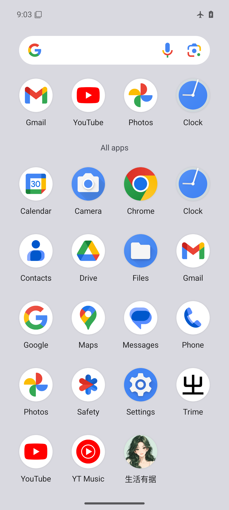

# 生活有据 1.0.2：女性二次元头像图标

日期：2026-09-30。本记录对应 1.0.2（versionCode 3）的 release APK。1.0.1 的目录验证保留在 [DIRECTORY_UPDATE.md](DIRECTORY_UPDATE.md)，1.0.0 的完整验收保留在 [TEST_REPORT.md](TEST_REPORT.md)。

## 本次更新

- 将应用的桌面、应用列表和系统应用信息图标更换为女性二次元头像：深绿色长发、绿色眼睛、米白衣服，搭配应用现有的浅绿色。
- 使用透明人物前景与独立背景组成 Android 自适应图标；普通图标和圆形图标使用同一资源，面部保留在中央，形状由桌面启动器裁切。
- 版本升级为 1.0.2 / versionCode 3，继续使用原安装签名。搜索、目录、阅读和用户数据处理逻辑没有变更。

图像由 Codex 内置 imagegen 工具生成。透明原图位于 [ic_launcher_avatar.png](../app/src/main/res/drawable-nodpi/ic_launcher_avatar.png)，完整提示词与布局依据见 [图标生成记录](icon/GENERATION.md)。

## 本轮实际验证

| 项目 | 结果 |
| --- | --- |
| `assembleRelease -Offline` | 成功生成 arm64-v8a 与 x86_64 APK，release 关键 lint 检查通过 |
| APK 版本 | 两种 ABI 均为 1.0.2 / versionCode 3，最低 API 26 |
| 图标打包 | Manifest 的 icon、roundIcon 均指向自适应图标；前景、背景和透明 PNG 均存在，PNG 可见像素及 alpha 与原图一致 |
| APK 完整性 | 两种 ABI 的离线资源及 DEX 一致，签名验证、ZIP 16 KB 对齐与 native PT_LOAD 对齐检查通过 |
| 升级签名 | 与已发布 1.0.1 的证书 SHA-256 一致 |
| Android 15 模拟器覆盖安装 | LifeEvidence_API35 / emulator-5580 / x86_64 / 4096 字节页，从 1.0.1 执行 `adb install -r` 成功升级到 1.0.2；firstInstallTime 保持一致 |
| 模拟器启动与显示 | 冷启动返回 Status: ok，主界面正常；桌面、应用列表及系统应用信息显示新头像，点选应用列表图标可回到主界面 |

签名证书 SHA-256：`051465e79fc8a75464a4a68a42d6e0df4ccf9d691ea06e2cd9973ab4c8bb15a0`。

结构化证据：[安装包验证](verification/icon-update/packages.json)、[版本与图标资源验证](verification/icon-update/icon-packages.json)、[升级与启动记录](verification/icon-update/summary.json)。AAPT 会归一化完全透明像素的 RGB；可见像素及透明度没有改变。

本轮仅修改图标、版本及交付文档，因此没有重新运行搜索、目录、联网更新或全套仪表测试；未在 16 KB 模拟器或红米真机上运行 1.0.2。静态对齐通过不等于这些设备已实测。升级过程未清除应用数据，也未逐项复验原有历史和收藏。模拟器原先无响应，核实 AVD 和端口后仅重启该项目专用实例，保留其数据。

## 实际截图

应用列表中的新头像：



其他截图：[桌面](verification/icon-update/launcher.png)、[系统应用信息](verification/icon-update/app-info.png)、[升级后主界面](verification/icon-update/app-launched.png)。

## 复现

```powershell
./tools/build.ps1 -Tasks assembleRelease -Offline
$env:JAVA_HOME = 'C:/Program Files/Eclipse Adoptium/jdk-17.0.18.8-hotspot'
python ./tools/verify_apks.py
$adb = "$env:LOCALAPPDATA/Android/Sdk/platform-tools/adb.exe"
& $adb -s emulator-5580 install -r ./app/build/outputs/apk/release/app-x86_64-release.apk
& $adb -s emulator-5580 shell am start -W -n app.shenghuoyouju/.MainActivity
python ./tools/package_source.py
```

手机使用 `LifeEvidence-1.0.2-arm64.apk`，模拟器使用 `LifeEvidence-1.0.2-x86_64.apk`。发布页另外提供完整源码 ZIP、公开验证记录 ZIP 和 SHA256SUMS.txt。
